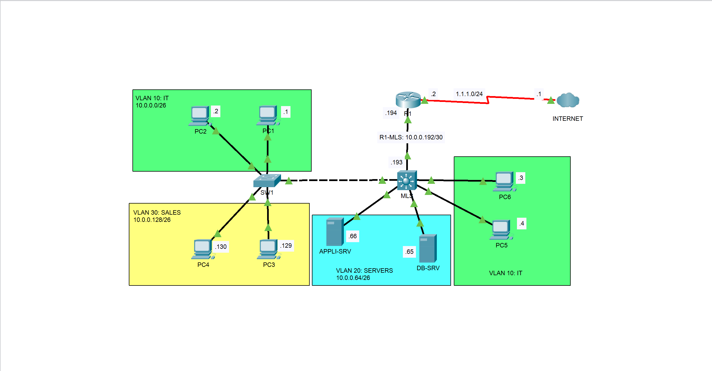

# Multi-Layer Switching Lab — Cisco Packet Tracer

## Overview

This project demonstrates a small enterprise network built with Cisco Packet Tracer. A multilayer switch (MLS) provides inter-VLAN routing, while a Layer 2 switch (SW1) connects end devices in the IT and SALES departments. An edge router (R1) connects the internal network to a simulated external network.

The lab focuses on VLAN segmentation, 802.1Q trunking, Switch Virtual Interfaces (SVIs), and Layer 3 connectivity between network devices.

## Objectives

- Create and assign VLANs to access ports.
- Configure an 802.1Q trunk between a Layer 2 switch and a multilayer switch.
- Configure SVIs to provide default gateways for the VLANs.
- Enable inter-VLAN routing on the multilayer switch.
- Configure a routed point-to-point link between the MLS and the edge router.
- Configure static routes and verify routing-table entries.
- Document the topology, device configurations, and verification outputs.

## Network Topology

The network consists of:

- **SW1:** Layer 2 switch connecting end devices in VLAN 10 (IT) and VLAN 30 (SALES).
- **MLS:** Multilayer switch providing Layer 3 routing between VLANs and connecting to the edge router.
- **R1:** Edge router connected to the simulated external network.
- **End devices and servers:** Hosts distributed across the IT, SERVERS, and SALES networks.



## IP Addressing Plan

| VLAN / Network | Purpose | Subnet | Default Gateway |
|---|---|---|---|
| VLAN 10 — IT | IT workstations | `10.0.0.0/26` | `10.0.0.62` |
| VLAN 20 — SERVERS | Application and database servers | `10.0.0.64/26` | `10.0.0.126` |
| VLAN 30 — SALES | Sales workstations | `10.0.0.128/26` | `10.0.0.190` |
| MLS–R1 link | Routed transit network | `10.0.0.192/30` | N/A |
| External network | Simulated external segment | `1.1.1.0/24` | Depends on the external-side configuration |

The MLS uses `10.0.0.193/30` on the routed link to R1, while R1 uses `10.0.0.194/30`.

## Key Configurations

### VLANs and access ports

- VLAN 10: IT
- VLAN 20: SERVERS
- VLAN 30: SALES

End-device ports are assigned to their respective VLANs.

### Trunk link

The SW1–MLS link is configured as an 802.1Q trunk that allows VLANs 10 and 30. Native VLAN 1001 is configured on both ends.

### Inter-VLAN routing

The MLS uses SVIs as the default gateways:

- VLAN 10: `10.0.0.62/26`
- VLAN 20: `10.0.0.126/26`
- VLAN 30: `10.0.0.190/26`

### Routed uplink and static routing

The MLS connects to R1 through a routed `/30` link. Static routes are present in the device configurations; see the configuration files for the exact commands.


## Verification

The collected command outputs in [`tests/shows.txt`](tests/shows.txt) document:

- VLAN assignments and trunk status.
- SVI and routed-interface status.
- The MLS routing table and its connected networks.
- Static route entries on the MLS and R1.

Screenshots in the `tests/` directory provide additional visual evidence from the lab.

**Note:** A configured route is not, by itself, proof of successful end-to-end connectivity. Verify the return path and test the external destination before claiming that external access works.

## Skills Practiced

- Cisco IOS configuration
- VLAN segmentation
- 802.1Q trunking
- Inter-VLAN routing with SVIs
- Layer 2 and Layer 3 switching
- Static routing
- Network troubleshooting and verification
- Technical documentation

## Repository Structure

```text
Multi-Layer-Switching/
├── configs/
│   └── Device configuration files (.txt)
├── docs/
│   ├── documentation.md
│   └── topology.png
├── src/
│   └── Multi-Layer-Switching.pkt
├── tests/
│   ├── simulation-mode.png
│   ├── end-to-end-connectivity.png
│   ├── shows.txt
│   └── Additional verification screenshots
├── .gitignore
├── LICENSE
└── README.md
```

See [`docs/documentation.md`](docs/documentation.md) for the detailed design, configuration approach, and verification procedures.

## Tools

- Cisco Packet Tracer
- Cisco IOS command-line interface (CLI)

## Author

**C. Victorin Vodinou**

Networking | Systems Administration | Network Security

[GitHub Profile](https://github.com/Victorin13)
[LinkedIn Profile](https://www.linkedin.com/in/victorin-vodinou/)
Gmail Prifile: victorinvodinou@gmail.com

This project is part of my hands-on networking lab portfolio.

## License

This project is distributed under the MIT License. See [`LICENSE`](LICENSE) for details.